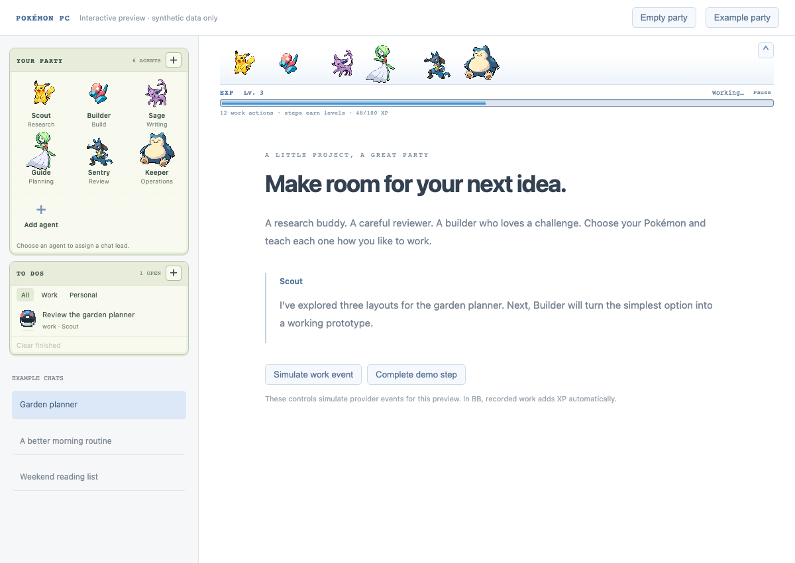
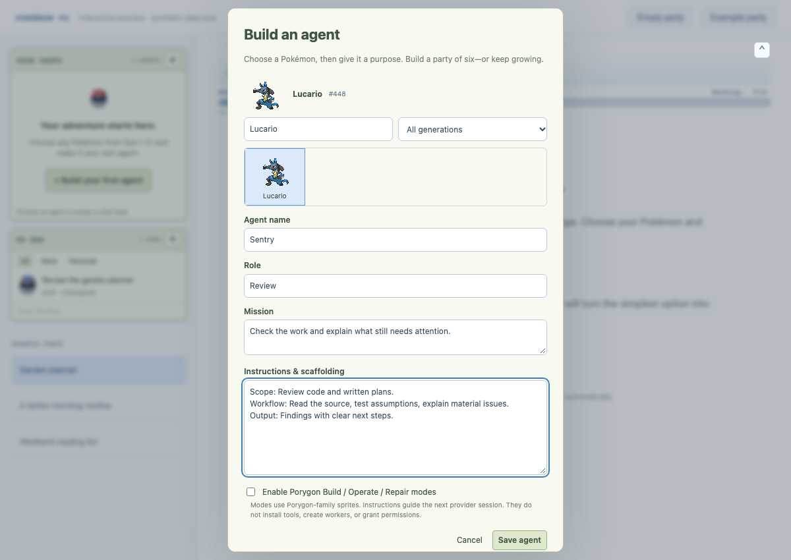
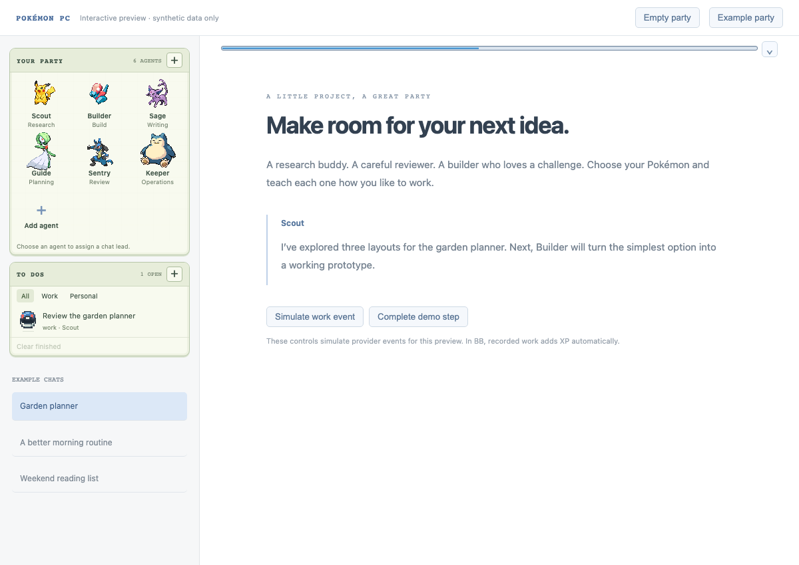

# Pokémon PC for BB

Build your own Pokémon party of agents, keep tasks in Poké Balls, and watch your team earn EXP as it works. A fresh install starts with an **empty party**. Pick any of the **493 Pokémon from Generations I–IV**, give each a role and instructions, and assemble a team of agents.



## Install

Requires **BB 0.49+**, **plugin SDK 0.6.132+**, Git, and the separate [Apple Notes plugin](https://github.com/pdaly23442/bb-apple-notes-theme), installed pinned to a reviewed commit. BB installs dependencies and builds Git plugins automatically.

```sh
bb plugin install git:https://github.com/pdaly23442/bb-apple-notes-theme.git@5298b3abed7a1ba7b2c46fc9979194893cbf76dd
bb plugin install git:https://github.com/pdaly23442/bb-pokemon-pc.git@v0.2.2
bb theme set plugin:pokemon-pc:daylight
```

Keep both plugins enabled. You can also select **Pokémon PC — Cobalt** in **Settings → Appearance**. The Apple Notes plugin supplies the notes layout behavior; this plugin adds the party, tasks, lead sprites, and EXP display. Its ID is `pokemon-pc` and its package name is `bb-plugin-pokemon-pc`.

Repository: [pdaly23442/bb-pokemon-pc](https://github.com/pdaly23442/bb-pokemon-pc).

## Build your party

Click **+** beside **Your Party**. Search Pokémon by name or Pokédex number, filter by generation, and write a name, role, mission, and instructions. Instructions can describe scope, authorized tools, workflow, expected output, and checks. No code editing is needed. The roster supports up to 100 saved agents, including archived profiles.



Click an agent to edit it or make it the current chat’s lead. Select supporting perspectives in its profile, or use a chat’s **Lead Pokémon** menu. Enable the optional Porygon modes to switch between **Build / Porygon**, **Operate / Porygon2**, and **Repair / Porygon-Z**. Archiving retains the profile and tasks but clears its lead/helper assignments; restore it from **Archived agents**.

### Choose who works on a new chat

The new-chat composer has an **Agent** button. Open it and choose:

- **Single**: one agent leads the chat.
- **Double battle**: choose a lead, then one partner. The lead owns the result and brings in its partner's expertise, and both sprites join the chat.

The pick is applied when you send the chat's first message, before BB starts the agent, so the profile is active from the first reply. It then resets to **Agent** for your next chat. Chats started by other agents or automations never use it. For chats already running, assigning a lead or changing perspectives applies only when BB next constructs that chat's provider session.

A double battle is two profiles guiding **one** session. It does not start a second agent. Assignment does not restart an active session, create independent workers, install tools, connect accounts, grant permissions, or isolate private data.

## Activity EXP

The display sits below each chat’s header. Assigned Pokémon stroll, hop, and look around while that chat is working. Click the corner **⌃** to keep only a thin EXP line; click **⌄** to expand it. **Pause** stops motion. Both choices persist locally in your browser, and reduced-motion preferences are respected.



Successful recorded work events—such as tool calls, searches, file operations, and commands—add 12 XP, up to 90. A completed structured plan step fills the bar, shows **Level up!**, then resets for the next step. Providers without structured plans level up on a successfully completed turn. Failed/interrupted work does not level up. This is **activity XP, not a prediction of percentage completion**, and it never completes a To Do automatically.

The plugin polls the open chat’s supported event stream every 2.5 seconds. Old chats show **Syncing history…** while catching up in bounded pages. The saved counters use event positions and hashes of completed step labels to avoid replaying progress; no command text, output, messages, or raw plan text is stored in the XP table. Identically named completed steps are counted once within the retained 2,048-label history; use distinct step labels for distinct milestones. Event coverage depends on the provider. Long operations without intermediate events leave XP unchanged until recorded work completes.

## To Dos

Use **+** beside **To Dos**, choose work/personal, the agent that should work on it, and one of eight ball skins. Change a task's agent at any time from the menu under its title. Personal tasks default to Quick Ball. Click a ball to complete or reopen a task. **Clear finished** archives completed tasks; **Undo** restores the batch. Tasks, profiles, assignments, and XP persist in BB-managed SQLite storage. The sidebar shows up to 200 unarchived tasks.

`bb pokemon-pc list --json` returns saved profiles, tasks, and assignments. See [the bundled skill](skills/pokemon-pc/SKILL.md) for evidence-based task completion and assignment commands.

## Development and preview

Use Node 22+ with a toolchain supported by `better-sqlite3` and a BB CLI meeting the requirements above.

```sh
npm ci --include=dev
npm run typecheck
npm run build
npm test
```

Tests need the native `better-sqlite3` binding. If your npm blocks lifecycle scripts, approve its pinned install script and run `npm rebuild better-sqlite3` before testing. SQLite is supplied by BB in a normal plugin installation; it is only a development dependency here.

```sh
npm run preview:build
python3 -m http.server 8080 --bind 127.0.0.1 --directory .preview
```

The preview uses the real UI components with **synthetic data** and never connects to BB. Its work-event controls are only demo fixtures. For automated visual checks: `npx playwright install chromium`, then `npm run test:browser`. Screenshots in this repository come only from that preview. See [validation](docs/validation.md).

## Security

Profile instructions are added to every chat that the profile leads, so treat them like any other agent instruction file. Other plugins cannot create, edit, archive, or assign profiles. BB gives local agents the same access as you, though: an agent running a shell can still reach the plugin or its database. The plugin limits the damage in two ways:

- **Agents get a warning label on profile text.** Injected profiles carry a notice that they're stored configuration, not messages from you. They can't authorize actions, and agents must report any requests to send data, contact people, or change settings instead of acting on them.
- **The bundled skill restricts agents.** It tells agents never to edit profiles or call the plugin's RPC directly. Agents must also treat To Do titles and evidence as data, and summarize tasks from email or chat in their own words.

If a profile's instructions look different from what you wrote, edit or archive it from the PC.

## Limits and rollback

Sprites load on demand from a pinned public [PokeAPI/sprites](https://github.com/PokeAPI/sprites) revision. Internet access is needed for uncached artwork; a Pokédex-number fallback keeps profiles usable if an image fails. Sidebar and header placement use BB DOM attributes and should be rechecked after major BB changes; the EXP component falls back to the thread context area if the header is unavailable. Split panes use their own chat IDs.

Switch to your previous theme to remove the PC boxes, EXP display, and sprite replacements. Disable `pokemon-pc` to stop role contributions. Saved data remains in BB-managed storage. No Apple Notes source files are rewritten. To return to the original notes appearance: `bb theme set plugin:apple-notes:notes`.

## Credits

The base stylesheet derives from Alana Goyal’s MIT-licensed Apple Notes BB theme; see [LICENSE-APPLE-NOTES](LICENSE-APPLE-NOTES). Lucide/Feather notices are retained in [THIRD-PARTY-NOTICES.md](THIRD-PARTY-NOTICES.md). Species names come from [PokeAPI/pokeapi](https://github.com/PokeAPI/pokeapi) under its retained [license](LICENSE-POKEAPI). Sprites use the Generation IV Platinum set; see the upstream [artwork notice](LICENSE-SPRITES).

Pokémon names and artwork belong to their respective owners. This is an unaffiliated fan project. The [MIT license](LICENSE) covers plugin code, not third-party artwork. Poké Ball SVGs are custom pixel-style drawings.
